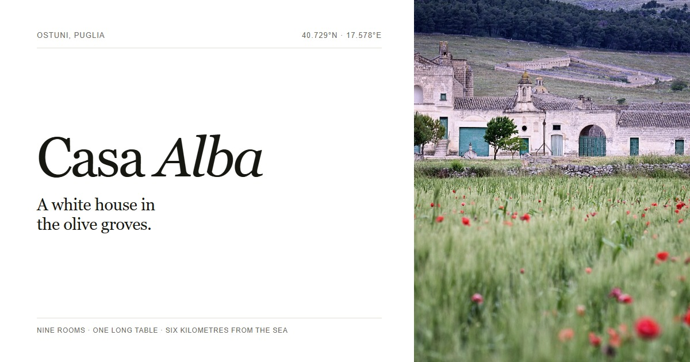

# Casa Alba

An editorial landing page for a fictional nine-room masseria in the olive groves between Ostuni and the Adriatic.

[**View the live site →**](https://palychdev.github.io/casa-alba/)



## What this is

Casa Alba is a design study, not a real hotel. The property, rates, menu, and address are invented. The photographs are real places in Puglia, plus three interior photographs from Unsplash.

The page is built as a complete, static site: no framework, no build step, no trackers, no cookies, and no analytics. It is deliberately white-dominant and editorial, with self-hosted type, hairline rules, asymmetric grids, and a small amount of motion.

## Run it locally

```bash
npm install
npm run serve
```

Open <http://127.0.0.1:4173>. The tiny local server is there because some browsers block self-hosted fonts when the page is opened directly from `file://`.

There is no build command. Edit the HTML, CSS, or JavaScript and refresh.

## What's inside

- `index.html` — the landing page
- `credits.html` — photography, type, and production notes
- `assets/css/style.css` — the whole design system in one stylesheet
- `assets/js/main.js` — menu, dates, form composition, local time, scroll reveals
- `assets/fonts/` — Fraunces and Instrument Sans, self-hosted in WOFF2
- `assets/img/` — seven source photographs and responsive AVIF/WebP derivatives
- `scripts/` — image optimisation, OG card generation, local server

## Forms

The enquiry form is a planner, not a booking engine. It validates the dates and keeps a summary on the page; nothing is sent to a server and there is no email address or mail app involved.

The date fields use the browser's native date control. Their placeholder format follows the visitor's browser locale, not the page language.

## Image pipeline

The responsive derivatives are committed so the site can be served without a build step. To regenerate them:

```bash
npm run images   # WebP at 900 / 1600 / original width
npm run avif     # AVIF at the same widths
npm run og       # rebuild assets/og.jpg
```

`scripts/avif.mjs` and `scripts/og.mjs` use Sharp and Playwright respectively.

## Credits

Photography and type are credited on the [credits page](https://palychdev.github.io/casa-alba/credits.html). The Wikimedia Commons photographs are used under CC BY-SA 3.0 or 4.0. The three Unsplash photographs are used under the Unsplash License. Fraunces and Instrument Sans are licensed under the SIL Open Font License; the license texts are in `assets/fonts/`.

## License

The code in this repository is available under the MIT License. Photographs and fonts are excluded from that license and remain under the terms listed on the credits page.
